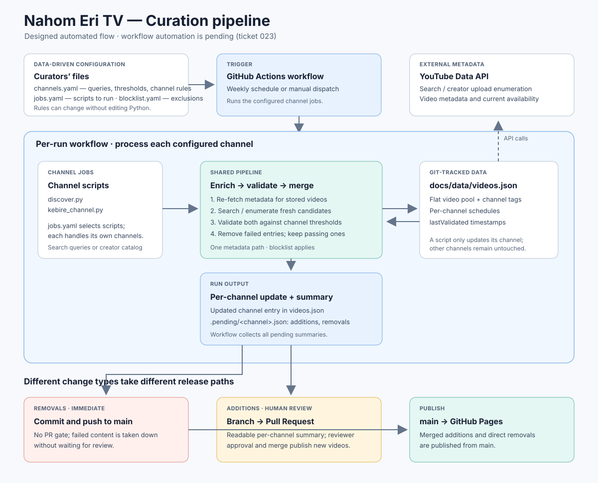

# Curation pipeline architecture



This describes the designed automated curation pipeline: a scheduled job that
replaces manually running `discover.py`/`kebire_channel.py` by hand. Some of
this is built already (`channels.yaml`, `jobs.yaml` — ticket 019); the rest
(`curation/pipeline.py`, the rewritten channel scripts, the GitHub Actions
workflow) is tracked in tickets 020–023. This doc describes the settled
design those tickets implement — if something shipped differently than
described here, trust the code and fix this doc, not the other way around.

## The three pillars

**Search.** Each channel in `channels.yaml` either runs a list of YouTube
search queries (`type: search`, e.g. Weddings' `["Tigrinya wedding",
"Eritrean wedding"]`) or enumerates one creator's entire upload history
(`type: channel`, e.g. Kebire, filtered by a required text match rather than
a query). Search is restricted to recently-published candidates only — its
job is finding videos that are *new since last run*, not re-discovering the
whole historical corpus every time. Search returns fully enriched candidate
records (title, duration, public/embeddable status, view count already
attached), not bare video IDs — there is exactly one place in the codebase
that calls `videos.list` to fetch this metadata, reused for both fresh
candidates and re-checking already-stored videos (see Validation).

**Validation.** A single pure function, with no API calls of its own: given
a video's metadata and a channel's thresholds (`view_count_min`,
`duration_min_sec` from `channels.yaml`), it decides pass or fail. It runs
twice per channel per job run — once over this run's fresh candidates, and
once over every video *already* in that channel's lineup. That second pass
is what makes "removal" mean something real (see below), rather than
inferring invalidity from "a search happened not to return it again."

**Storage.** `docs/data/videos.json` keeps its existing shape: a flat pool
of videos (each tagged with which channel(s) it belongs to) plus a
`schedules` map (one `scheduleStart` per channel, exactly one marked
`default: true`). New field: every video gets a `lastValidated` timestamp,
stamped whenever it passes a validation pass — so "the pipeline is actually
re-checking old entries" is visible in the data, not just asserted.

## Why removals bypass PR review but additions don't

A video dropping out of a channel — because it's now blocklisted, gone
private, or no longer embeddable — only ever *reduces* risk. There's no
judgment call to make about removing something that's already failed an
objective check. Gating that behind a human merging a PR would directly
contradict the design doc's same-day takedown commitment: a takedown request
should not have to wait for someone to notice and approve a pull request.

A newly discovered video is the opposite: it's an untested addition that
could be low-quality, miscategorized, or (per tickets 002 and 016's
precedent) carry a real copyright or relevance risk a human should glance at
before it goes live. So additions route through a Pull Request with a
readable per-channel summary, and removals are committed straight to `main`.

## Why `channels.yaml` instead of hardcoded Python

The project's established principle — non-developers edit data, not code
(the same reasoning behind `blocklist.yaml` living as a plain file) — extends
naturally to channel rules. Before this, adding a query or a new search-based
channel meant editing `discover.py`'s source. `channels.yaml` makes that a
data change: a new entry, or one more line in an existing `queries` list,
with no code touched. This is what actually generalizes the pipeline beyond
Weddings and Kebire (superseding the earlier, narrower ticket 018).

## Why this isn't a database

Covered in detail earlier in the project's design discussion; the short
version: everything this pipeline does — reviewing a change via PR,
editing a rule via GitHub's web UI, diffing what changed between runs —
depends on the data being plain, git-tracked text. A database would lose all
three of those for free and gain nothing at this project's scale (a handful
of channels, weekly runs, one writer at a time). If a future need for a
non-technical dashboard ever arises, the better answer is a thin form/sheet
in front of these same files, not a database replacing them.

## End-to-end data flow

```
trigger (weekly schedule, or manual workflow_dispatch)
  │
  ▼
for each script listed in jobs.yaml (discover.py, kebire_channel.py):
  for each channel it owns (from channels.yaml):
    ├─ re-validate this channel's already-stored videos
    │    (re-fetch metadata → validate → kept or removed)
    └─ search/enumerate for new candidates
         (search or playlist walk → validate → added or discarded)
    → write the channel's updated entry into videos.json
    → write curation/.pending/<channel>.json: {additions, removals}
  │
  ▼
workflow collects all .pending/*.json summaries:
  ├─ REMOVALS → applied directly to videos.json on `main`, committed
  │             and pushed immediately, no review gate
  └─ ADDITIONS → committed to a standing branch (curation/weekly-update),
                 a Pull Request opened or updated with a human-readable
                 summary, owner auto-assigned as reviewer
                 (skipped entirely if there are no additions this run)
  │
  ▼
merging the PR publishes it — GitHub Pages deploys straight from `main`
```
