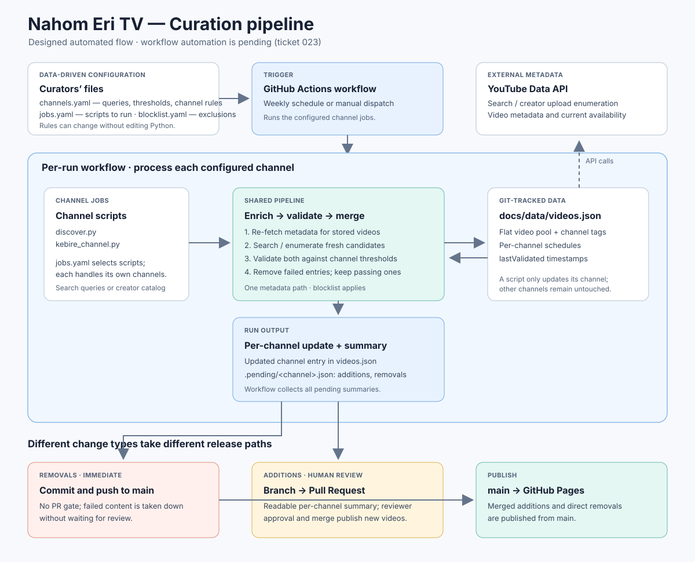

# Curation

See [`ARCHITECTURE.md`](ARCHITECTURE.md) for the full design of the automated curation pipeline (search, validation, storage, and why additions vs. removals are handled differently).



`../docs/data/videos.json` holds a flat pool of videos (each tagged with a `channels` array) plus a `schedules` map with one entry per channel (`scheduleStart`, and `default: true` on exactly one channel). Each script below only ever replaces its own channel's videos and leaves every other channel's entries and schedule untouched — see `merge_channel` in `fetch_metadata.py`, which the other scripts reuse.

## Automated runs

Once ticket 023 ships, the pipeline runs weekly on its own via GitHub Actions, and a run can also be forced on demand:

```
gh workflow run curate.yml
```

(Not available yet — `.github/workflows/curate.yml` doesn't exist until ticket 023 lands. Until then, run the scripts below by hand.)

## Weddings channel

Hand-picked bootstrap:
1. Add hand-picked videos to `seed_videos.yaml` (one entry per video).
2. `export YOUTUBE_API_KEY=...`
3. `pip install -r requirements.txt`
4. `python fetch_metadata.py`

Automated discovery (M4, replaces hand-picking — see `discover.py`'s `RULES`):
- `python discover.py`

## Kebire channel

Every public, embeddable video from Kebire's YouTube channel containing `#eritrea` in its title or description (no view-count filter — this is one known creator's catalog, not an unvetted pool):
- `python kebire_channel.py`

## Live events

A temporary guide row featuring an existing third-party live YouTube stream
of a single scheduled occasion (a wedding, a festival) — manually submitted,
never run by the automated pipeline:
1. Add an entry to `live_events.yaml` via a normal PR (one entry per event).
2. `export YOUTUBE_API_KEY=...`
3. `python merge_live_events.py`

This writes/updates the top-level `liveEvents` array in `../docs/data/videos.json`,
leaving `videos`/`schedules` untouched. A malformed entry (missing a
required field, or an unparseable `scheduled_start`) is rejected with a
warning rather than written.

## Excluding a video

Add it to `blocklist.yaml` (with a reason and date) and re-run whichever script generated it.
